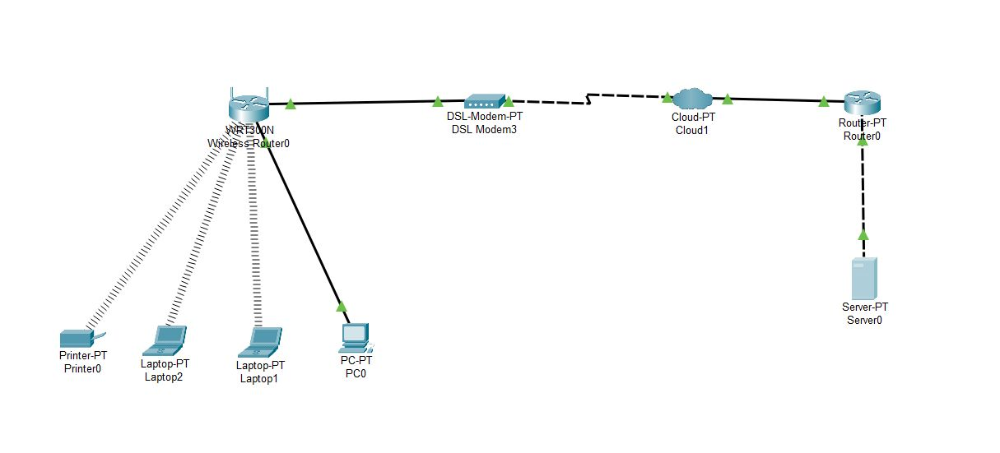
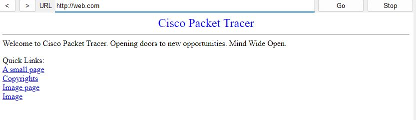
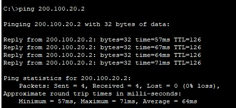
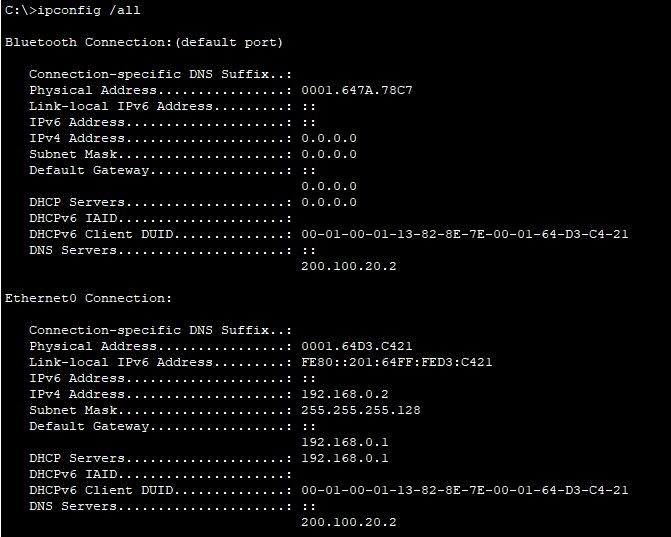

# 🏠 Rede Doméstica/SOHO Segura e Acesso Web via Nuvem

Projeto prático desenvolvido no **Cisco Packet Tracer** como parte do meu portfólio de redes e infraestrutura, aplicando os conceitos da certificação **Networking Basics** da Cisco Networking Academy.

## 🎯 Objetivo
Projetar, configurar e validar uma rede local (LAN) híbrida para pequeno escritório/residência (SOHO), atendendo estações cabeadas e dispositivos sem fio com segurança wireless, atribuição automatizada de endereços IP e acesso a um servidor web externo simulando a internet.

## 🏗️ Topologia da Rede

### Equipamentos Utilizados
* **Roteador Wireless:** Cisco WRT300N (Gateway LAN, NAT, DHCP e Access Point)
* **Acesso WAN / Internet:** Cable Modem (`Cable Modem0`), Nuvem (`Cloud-PT`) e Roteador de Borda (`Router-PT`)
* **Servidor Externo:** `Server0` (hospedagem HTTP e resolução de nomes DNS)
* **Clientes de Rede:** Estação de trabalho cabeada (`PC`), notebooks via Wi-Fi (`Laptop1`, `Laptop2`) e impressora de rede (`Printer0`)

## 📋 Tabela de Endereçamento IPv4

| Segmento | Rede / Máscara | Dispositivo | Interface | Endereço IP | Observação |
| :--- | :--- | :--- | :--- | :--- | :--- |
| **LAN Interna (SOHO)** | `192.168.0.0/24` | WRT300N | LAN / Wireless | `192.168.0.1` | Gateway Padrão e Servidor DHCP |
| **LAN Interna (SOHO)** | `192.168.0.0/24` | PC / Laptops | Ethernet / Wireless | `192.168.0.x` | Atribuição dinâmica via DHCP |
| **LAN Interna (SOHO)** | `192.168.0.0/24` | Printer0 | Wireless | IP Reservado | Reserva fixa (Static DHCP por MAC) |
| **Enlace WAN (Nuvem)** | `200.100.10.0/30` | WRT300N | Internet (WAN) | `200.100.10.2` | IP Estático (Gateway `200.100.10.1`) |
| **Enlace WAN (Nuvem)** | `200.100.10.0/30` | Router-PT | Serial | `200.100.10.1` | Conectado à ponte Coaxial-Serial da Nuvem |
| **Rede Externa (DMZ)** | `200.100.20.0/24` | Router-PT | FastEthernet | `200.100.20.1` | Gateway do Servidor Web/DNS |
| **Rede Externa (DMZ)** | `200.100.20.0/24` | Server0 | FastEthernet0 | `200.100.20.2` | Servidor HTTP e DNS (`web.com`) |

## 🛠️ Tecnologias e Configurações Aplicadas
* **Roteamento e NAT:** Tradução de endereços no roteador wireless WRT300N entre a rede privada interna e a interface WAN pública.
* **Simulação de Provedor (Cloud-PT):** Mapeamento interno interligando a interface Coaxial (modem) à interface Serial (roteador de borda).
* **Segurança Wireless (WPA2-PSK):** Criptografia WPA2 com autenticação por senha para proteção do tráfego sem fio dos notebooks e da impressora.
* **DHCP e Reserva de IP (Static DHCP):** Distribuição automática de IPs na LAN e reserva vinculada ao endereço MAC da impressora de rede para manter seu endereço fixo.
* **Serviços DNS e HTTP:** Configuração de zona DNS (`web.com` apontando para `200.100.20.2`) e hospedagem de página web no `Server0`.

## ✅ Testes e Validação

### 1. Resolução de Nomes (DNS) e Acesso Web (HTTP)
Acesso à página hospedada no servidor externo diretamente pelo navegador de uma estação interna utilizando o domínio `web.com`:

### 2. Conectividade e Configuração IP (`ping` e `ipconfig /all`)
Validação dos parâmetros recebidos via DHCP (incluindo o servidor DNS) e teste de alcance ponta a ponta até `200.100.20.2`:

## 📂 Como executar o projeto
1. Faça o download do arquivo `.pkt` disponível neste repositório.
2. Abra o arquivo no **Cisco Packet Tracer** (versão 8.0 ou superior).
